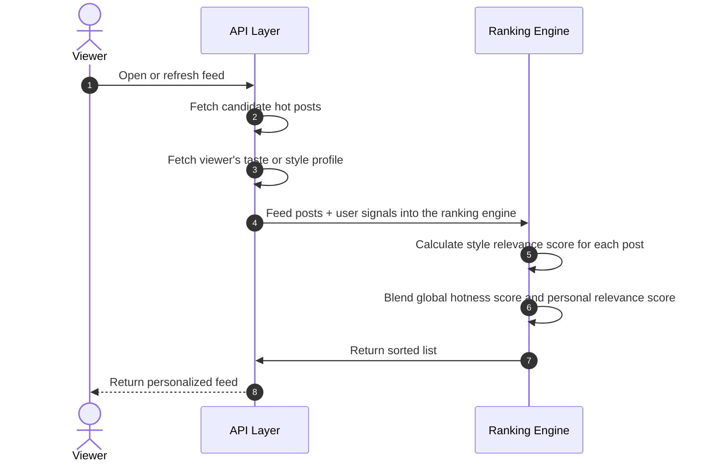

# Two-Stage Hybrid Feed Algorithm (Archived)

> **Status:** Archived per ADR 002 — Community Social Feed removed from MVP core.
> **Decision Date:** 2026-06-28
> **Reason:** Community post feature, resale, and P2P transfer were removed to focus on Digital Wardrobe + AI Outfit Assistant + B2B services.
> **See also:** `docs/decisions/002-remove-community-resale.md`, `docs/project/scope.md`, `docs/project/vision.md`

---

The discovery system splits the global background computation part and the real-time personalized ranking part, helping to achieve lower latency.

### 1. Stage 1: Calculating Global Hotness Score via Time-Decay

A separate background process evaluates community interactions to update the post's global hotness index.

#### Target Design

$$\text{Global\_Score} = \text{Time-Decay}(\text{like\_count}, \text{comment\_count}, \text{item\_age})$$

This model emphasizes that hotness should not solely rely on raw interaction counts, but needs to gradually decay over time.

#### Current Version (at time of archiving)

The backend had:

- Hot feed
- Candidate post set for personalized hot feed
- Global hotness score at snapshot
- Sorting logic combining hotness score and personal relevance score

### 2. Stage 2: Real-time Personalization and Score Blending

When the user opens the feed, the system combines global data and personalization signals.

#### Step A: Synthesizing user vectors or profiles

The old design assumes the system has a separate fashion taste vector for the viewer.

#### Current Version (at time of archiving)

Code had `StyleProfile` or `TasteEmbedding` on the user and used it to calculate style scores for the personalized hot feed.

#### Step B: Calculating style relevance score

The old design uses max pooling logic on items within the post.

#### Current Version (at time of archiving)

The backend had a step to calculate style scores based on items in the post and the user's embedding, then blends the score with the global hotness score.

#### Step C: Linear score blending

The old design describes the formula:

$$\text{Final\_Feed\_Score} = (\text{Global\_Score} \times 0.4) + (S_{\text{style}} \times 0.6)$$

#### Current Version (at time of archiving)

The version followed this spirit: blending global hotness score with personal relevance score to create a personalized hot feed.
