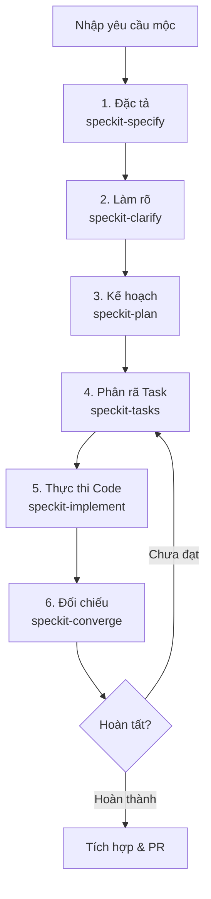

# Quy Trình Phát Triển Tính Năng Với Agent & Spec-kit (Specify)

Tài liệu này hướng dẫn cách thức tương tác giữa lập trình viên (Developer), trợ lý lập trình AI (Agent) và công cụ quản lý quy trình **Spec-kit (Specify)** để phát triển tính năng mới trong dự án SmartWardrobe Backend một cách chuẩn chỉ, an toàn và đúng cấu trúc.

---

## I. Tổng Quan Quy Trình (Workflow)

Quy trình Spec-kit chia quá trình phát triển tính năng thành các giai đoạn độc lập, có tuần tự rõ ràng từ đặc tả, lập kế hoạch, tạo danh sách công việc cho tới thực thi và đối chiếu.

---

## II. Các Giai Đoạn & Lệnh Thực Thi

Khi bắt đầu một tính năng mới (ví dụ: `b2b-campaign-points`), bạn sẽ tạo một nhánh git tương ứng (ví dụ: `feat/b2b-campaign-points`) và bắt đầu chạy tuần tự các lệnh tương tác dưới đây:

### 1. Giai Đoạn 1: Đặc Tả Tính Năng (Specification)
*   **Lệnh:** `@[/speckit-specify] [Mô tả tính năng mộc]`
*   **Mục đích:** AI sẽ phân tích yêu cầu của bạn và tạo ra file đặc tả tính năng tại `specs/[###-feature-name]/spec.md`. File này bao gồm:
    *   **User Stories (Kịch bản sử dụng)**: Định nghĩa rõ các luồng người dùng dưới dạng độc lập và kiểm thử được độc lập.
    *   **Requirements (Yêu cầu)**: Yêu cầu chức năng chi tiết.
    *   **Success Criteria (Tiêu chí thành công)**: Các tiêu chí có thể đo lường được.

### 2. Giai Đoạn 2: Làm Rõ Đặc Tả (Clarify)
*   **Lệnh:** `@[/speckit-clarify]`
*   **Mục đích:** AI sẽ quét file `spec.md` vừa tạo để tìm ra các điểm chưa rõ ràng, thiếu chi tiết hoặc mâu thuẫn kỹ thuật. AI sẽ hỏi tối đa 5 câu hỏi trọng tâm. Sau khi bạn trả lời, các thông tin này sẽ được cập nhật ngược lại vào file `spec.md`.

### 3. Giai Đoạn 3: Lập Kế Hoạch Thiết Kế (Plan)
*   **Lệnh:** `@[/speckit-plan]`
*   **Mục đích:** Tạo bản kế hoạch kỹ thuật chi tiết tại `specs/[###-feature-name]/plan.md`. Giai đoạn này thực hiện:
    *   **Constitution Check**: Đối chiếu thiết kế với **Hiến pháp dự án** (`.specify/memory/constitution.md`) xem có vi phạm quy định nào không (ví dụ: preloads chéo, sai layer, không dùng contract).
    *   **Data Model & Contract Design**: Định nghĩa các thực thể (entities), API Endpoints, cấu trúc DTO, và sự thay đổi Database Schema.
    *   **Research**: Nghiên cứu và xác định thư viện bên thứ ba cần dùng.

### 4. Giai Đoạn 4: Phân Rã Công Việc (Tasks)
*   **Lệnh:** `@[/speckit-tasks]` (hoặc `@[/speckit-taskstoissues]` nếu muốn đẩy lên GitHub Issues)
*   **Mục đích:** Sinh ra danh sách các công việc cụ thể tại `specs/[###-feature-name]/tasks.md`.
    *   Các task được nhóm theo từng **User Story** để đảm bảo tính độc lập khi triển khai.
    *   Có ghi chú rõ các task chạy song song được `[P]` hoặc các task tiền đề.
    *   Mỗi task đều đi kèm đường dẫn file cụ thể cần sửa/tạo mới.

### 5. Giai Đoạn 5: Triển Khai Code (Implement)
*   **Lệnh:** `@[/speckit-implement]`
*   **Mục đích:** Đọc danh sách nhiệm vụ từ `tasks.md` và tiến hành code tuần tự.
    *   AI sẽ thực hiện từng task một.
    *   Sau mỗi task thành công, AI sẽ tự động cập nhật trạng thái đã hoàn thành (`[x]`) vào file `tasks.md`.
    *   Nếu có lỗi xảy ra, AI sẽ dừng lại và báo cáo để bạn cùng xử lý.

### 6. Giai Đoạn 6: Đối Chiếu & Kiểm Tra (Converge)
*   **Lệnh:** `@[/speckit-converge]`
*   **Mục đích:** Đối chiếu toàn bộ codebase hiện tại với Spec và Plan gốc xem còn phần nào chưa được triển khai đầy đủ hoặc có sai lệch không. Lệnh này sẽ bổ sung các task còn thiếu vào `tasks.md` để đảm bảo chất lượng đầu ra.

---

## III. Nguyên Tắc Cốt Lõi Khi Làm Việc Với Agent & Spec-kit

1.  **Hiến Pháp Là Tối Cao**: File `.specify/memory/constitution.md` quy định tất cả luật lệ thiết kế của dự án. Mọi thiết kế tại bước `speckit-plan` bắt buộc phải tuân thủ Hiến pháp. Nếu có mâu thuẫn, bạn phải cập nhật Hiến pháp trước khi code.
2.  **Làm Việc Theo Từng Task Nhỏ**: Không yêu cầu Agent viết toàn bộ tính năng cùng lúc. Hãy để Agent đi theo luồng `speckit-implement` để kiểm soát chất lượng code của từng module nhỏ lẻ, tránh xung đột và lỗi logic lớn.
3.  **Kiểm Thử Sau Mỗi Bước**: Sau khi Agent hoàn thành mỗi task quan trọng hoặc mỗi User Story, hãy chạy `make test` và `make check` để chắc chắn không xảy ra lỗi biên dịch hoặc lỗi kiểm thử ngoài mong muốn.
4.  **Lưu Trữ Trong Thư Mục `specs/`**: Tất cả tài liệu đặc tả, kế hoạch và danh sách task liên quan đến tính năng đang làm đều phải nằm trong thư mục `specs/[###-tên-tính-năng]/`. Thư mục này không được xóa mà phải commit cùng code lên Git để làm tài liệu đối chiếu sau này.
