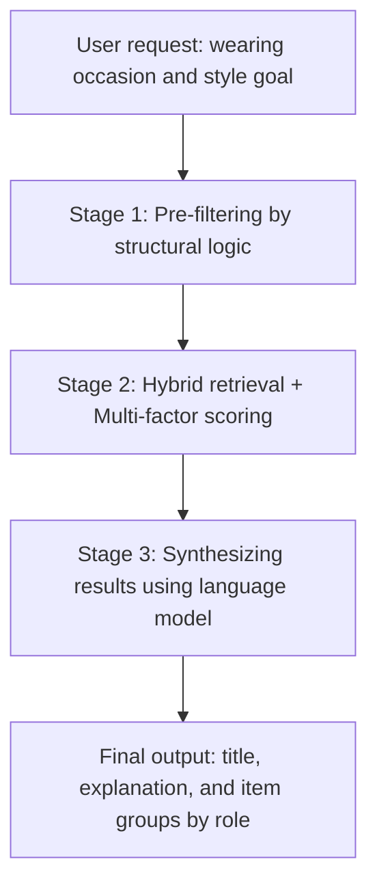

# Core pipeline and algorithmic flow specification of the system

## I. AI pipelines and advanced digital wardrobe

### 1. Asynchronous wardrobe digitization flow

To keep the system responsive during computationally heavy phases, the wardrobe digitization pipeline decouples user requests from background AI analysis through an event-based mechanism.

#### Target Design

- The client handles media uploads and pushes images to storage infrastructure.
- The API receives the request and returns a quick acceptance response instead of waiting for the AI to finish processing.
- The system maps AI results into domain data before officially saving it.

#### Current Version

The current version of the backend has clearly implemented this part as:

- API for batch upload wardrobe items
- Quick item creation with processing status
- Triggering background jobs for each item
- Workers consuming jobs
- AI analyzing images, generating metadata and embeddings
- Updating the item again after completion
- Featuring retry and backoff for temporary errors

In other words, the old asynchronous description was not removed, but implemented into a more concrete background pipeline.

#### Data Mapping Rules

The old descriptions about taxonomy normalization, color grouping, or AI label mapping to domain data still need to be kept as important directions, as this is the middleware layer enabling AI data to be used in the real system.

### 2. Multi-Stage Outfit Recommendation Pipeline

To avoid injecting the entire wardrobe into the prompt causing massive token cost spikes, the system uses a multi-stage pipeline approach to refine data before synthesizing the outfit.

#### Pipeline Stages

- **Stage 1:** Eliminate unavailable or contextually inappropriate items (ownership, processing status, category).
- **Stage 2:** Hybrid retrieval combining vector similarity search (pgvector) and full-text search (PostgreSQL FTS) merged via Reciprocal Rank Fusion, followed by multi-factor scoring: style match, occasion fit, color tone compatibility, weather appropriateness, seasonality, recency penalty, lexical boost, and long-unworn bonus.
- **Stage 3:** Use the language model to generate the complete outfit, explanation, and item group structure, with a local HSL-based color harmony fallback when the AI call fails.

#### Current Implementation

The current backend implements the full pipeline:

- `RecommendOutfit` API with quota validation, active item filtering
- NLP-based intent parser (Vietnamese) for free-text queries
- Hybrid search (pgvector cosine + FTS + RRF) across wardrobe items
- Multi-factor candidate scoring and diversification
- AI generation with structured JSON output, validated against actual wardrobe items
- HSL-based local fallback (`RunLocalHSLMatching`) when AI generation fails
- Output format: `title`, `explanation`, `items` by `role`, each role has one `primary` and multiple `alternatives`
- Quota deduction and `last_used_at` tracking on save

#### Business Output Shape of Recommendation

According to current expectations, a recommendation is not just a single "complete outfit", but a result package that can aid decision-making:

- `title`: Name or label of the suggested outfit
- `explanation`: Reason why the suggestion fits the occasion, style, or context
- `items`: Set of item groups by role

Each item group by role includes:

- `role`: Role of the item in the outfit
- `primary`: The prioritized item
- `alternatives`: Alternative items for the same role

The business meaning of this output format is:

- The frontend can display the outfit more flexibly
- Users can easily understand why the outfit was selected
- The system has a foundation ready for local swap or re-roll per role
- The recommendation is no longer locked into a single option

### Current Version of Local Swap

In the current version, local swap is supported by allowing the frontend to directly use the `alternatives` array of each role.

This means:

- The backend does not need to open a separate swap flow for each item change
- Local swap does not consume additional new outfit quotas
- The number of local swaps is not limited by the backend per swap turn
### 4. Outfit Combination & Validation Rules

To enforce core fashion domain validity, all outfit recommendations produced by LLM synthesis or HSL fallback MUST strictly adhere to one of the following two structural formulas:

- **Structure 1 (One-piece Outfit):** Must contain exactly 1 item of category `dam` (`fullbody`). MUST NOT contain any item of category `ao`, `quan`, or `chan-vay`.
- **Structure 2 (Separates Outfit):** Must contain exactly 1 item of category `ao` (`top`) AND 1 item of category `quan` or `chan-vay` (`bottom`). MUST NOT contain any item of category `dam`.

Both structures also require 1 item of category `giay` (`footwear`).

#### Optional Layering Roles

The two structures above define only the outfit *core*. On top of the core, three wearing roles are treated as optional layers. Neither LLM synthesis nor HSL fallback may drop them merely because the core is already valid:

- **`headwear`** (`mu`) and **`accessory`** (`phu-kien`): whenever the candidate pool contains a suitable candidate, the outfit SHOULD include that role. They are independent of the core pairing rules and may be added to either structure.
- **`outerwear`** (`ao-khoac`): an optional layer over either structure. Include it when the weather is cold/cool/rainy, when the season is autumn/winter, or when the request context explicitly asks for a layered outfit. Never include heavy outerwear when the weather is hot or sunny.

Because candidate diversification caps items per category and caps the total pool size, Stage 2 MUST backfill these optional roles from the scored pool after diversification, otherwise low-scoring hats and accessories never reach the prompt. The LLM response schema MUST constrain `role` to the fixed enum of all wearing roles so providers cannot return invented values.

#### Early Guard & Error Reporting
If a user's active wardrobe or query filters result in a candidate pool lacking the minimum body items (i.e. no `dam` AND no `ao` available, even after automatic candidate pool recovery), the system halts early in Stage 1/2 and returns `ErrInsufficientOutfitComponents` (HTTP 400 Bad Request) without deducting daily AI quota or invoking LLM generation.

### 3. Context-Augmented AI Stylist Chat

Chatbot interactions in the system use a context-augmented approach: wardrobe data, brand items, and conversation history are injected into the system prompt so the AI can answer fashion-related questions without needing dynamic tool calls.

#### Architecture

- **Conversation memory:** The system stores a `context_summary` per session, periodically compressed by AI to avoid token bloat. Recent raw messages are included directly in the prompt.
- **Context injection:** Wardrobe items, brand items, and the compressed summary are placed into the system prompt before each AI call.
- **Streaming response:** AI responses are streamed via SSE, filtered for thinking markers (`===RESPONSE===` tag), then persisted to the database.
- **Outfit intent detection:** The system checks if the user message requests an outfit recommendation, and if so, returns a redirect signal to the frontend (no AI deduction consumed).

#### Current Implementation

The current backend has:

- Session CRUD (create, list, archive, delete, update)
- Paginated message history
- SSE streaming for AI responses (`POST .../messages/stream`)
- Context summary compression (AI-based summarization after threshold)
- Wardrobe-related query detection (`isWardrobeRelatedQuery`)
- Full AI quota management through the aiexecutor module

The chat is powered by a prompt-injection pattern rather than a tool-calling ReAct agent. Data is pre-fetched and embedded in the system prompt, not retrieved dynamically during the conversation. This design is sufficient for the current product scope and avoids the complexity of function-calling orchestration.
