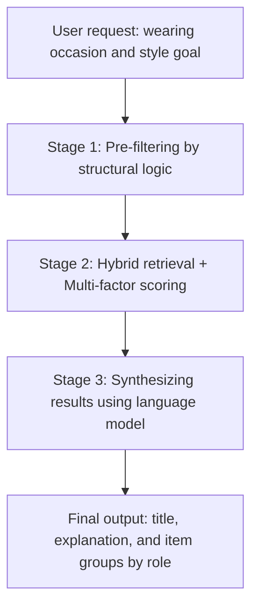

# Core pipeline and algorithmic flow specification of the system

## I. AI pipelines and advanced digital wardrobe

### 1. Asynchronous wardrobe digitization flow

To keep the system responsive during computationally heavy phases, the wardrobe digitization pipeline decouples user requests from background AI analysis through an event-based mechanism.

#### Target Design

- The client handles media uploads and pushes images to storage infrastructure.
- The API receives the request and returns a quick acceptance response instead of waiting for the AI to finish processing.
- The system maps AI results into domain data before officially saving it.

#### Current Version

The current version of the backend has clearly implemented this part as:

- API for batch upload wardrobe items
- Quick item creation with processing status
- Triggering background jobs for each item
- Workers consuming jobs
- AI analyzing images, generating metadata and embeddings
- Updating the item again after completion
- Featuring retry and backoff for temporary errors

In other words, the old asynchronous description was not removed, but implemented into a more concrete background pipeline.

#### Data Mapping Rules

The old descriptions about taxonomy normalization, color grouping, or AI label mapping to domain data still need to be kept as important directions, as this is the middleware layer enabling AI data to be used in the real system.

### 2. Multi-Stage Outfit Recommendation Pipeline

To avoid injecting the entire wardrobe into the prompt causing massive token cost spikes, the system uses a multi-stage pipeline approach to refine data before synthesizing the outfit.



#### Pipeline Stages

- **Stage 1:** Eliminate unavailable or contextually inappropriate items (ownership, processing status, category).
- **Stage 2:** Hybrid retrieval combining vector similarity search (pgvector) and full-text search (PostgreSQL FTS) merged via Reciprocal Rank Fusion, followed by multi-factor scoring: style match, occasion fit, color tone compatibility, weather appropriateness, seasonality, recency penalty, lexical boost, and long-unworn bonus.
- **Stage 3:** Use the language model to generate the complete outfit, explanation, and item group structure, with a local HSL-based color harmony fallback when the AI call fails.

#### Current Implementation

The current backend implements the full pipeline:

- `RecommendOutfit` API with quota validation, active item filtering
- NLP-based intent parser (Vietnamese) for free-text queries
- Hybrid search (pgvector cosine + FTS + RRF) across wardrobe items
- Multi-factor candidate scoring and diversification
- AI generation with structured JSON output, validated against actual wardrobe items
- HSL-based local fallback (`RunLocalHSLMatching`) when AI generation fails
- Output format: `title`, `explanation`, `items` by `role`, each role has one `primary` and multiple `alternatives`
- Quota deduction and `last_used_at` tracking on save

#### Business Output Shape of Recommendation

According to current expectations, a recommendation is not just a single "complete outfit", but a result package that can aid decision-making:

- `title`: Name or label of the suggested outfit
- `explanation`: Reason why the suggestion fits the occasion, style, or context
- `items`: Set of item groups by role

Each item group by role includes:

- `role`: Role of the item in the outfit
- `primary`: The prioritized item
- `alternatives`: Alternative items for the same role

The business meaning of this output format is:

- The frontend can display the outfit more flexibly
- Users can easily understand why the outfit was selected
- The system has a foundation ready for local swap or re-roll per role
- The recommendation is no longer locked into a single option

### Current Version of Local Swap

In the current version, local swap is supported by allowing the frontend to directly use the `alternatives` array of each role.

This means:

- The backend does not need to open a separate swap flow for each item change
- Local swap does not consume additional new outfit quotas
- The number of local swaps is not limited by the backend per swap turn
### 4. Outfit Combination & Validation Rules

To enforce core fashion domain validity, all outfit recommendations produced by LLM synthesis or HSL fallback MUST strictly adhere to one of the following two structural formulas:

- **Structure 1 (One-piece Outfit):** Must contain exactly 1 item of category `dam` (`fullbody`). MUST NOT contain any item of category `ao`, `quan`, or `chan-vay`.
- **Structure 2 (Separates Outfit):** Must contain exactly 1 item of category `ao` (`top`) AND 1 item of category `quan` or `chan-vay` (`bottom`). MUST NOT contain any item of category `dam`.

Both structures also require 1 item of category `giay` (`footwear`).

#### Optional Layering Roles

The two structures above define only the outfit *core*. On top of the core, three wearing roles are treated as optional layers. Neither LLM synthesis nor HSL fallback may drop them merely because the core is already valid:

- **`headwear`** (`mu`) and **`accessory`** (`phu-kien`): whenever the candidate pool contains a suitable candidate, the outfit SHOULD include that role. They are independent of the core pairing rules and may be added to either structure.
- **`outerwear`** (`ao-khoac`): an optional layer over either structure. Include it when the weather is cold/cool/rainy, when the season is autumn/winter, or when the request context explicitly asks for a layered outfit. Never include heavy outerwear when the weather is hot or sunny.

Because candidate diversification caps items per category and caps the total pool size, Stage 2 MUST backfill these optional roles from the scored pool after diversification, otherwise low-scoring hats and accessories never reach the prompt. The LLM response schema MUST constrain `role` to the fixed enum of all wearing roles so providers cannot return invented values.

##### Two-Layer Guarantee

Optional layering roles are enforced at two independent layers, and **both are required** — neither layer is sufficient on its own:

1. **Candidate layer (Stage 2):** the post-diversification guard backfills `headwear`, `accessory` and `outerwear` into the prompt pool, guaranteeing suitable *candidates exist*.
2. **Response layer (Stage 3):** `MapLLMResponseToGroups` backfills any still-missing `headwear` and `accessory` group from the pool after parsing the LLM response, guaranteeing the *roles appear in the output*.

Layer 1 alone still let the LLM omit a role on any given call, producing outfits that randomly contained a hat but no accessory, or vice versa. Layer 2 removes that non-determinism. `outerwear` is intentionally excluded from the layer-2 backfill because it is weather-, season- and intent-dependent, so it stays under the control of scoring, prompt rules and the HSL fallback.

#### Prompt Budget Constraint

`headwear` and `accessory` candidates are backfilled from the lowest-scored tail of the pool, and `BuildRecommendationPromptWithLimits` truncates from the **tail** of the candidate list. The configuration therefore requires headroom:

```
recommendation_minimum_candidate_pool + len(optional roles) < recommendation_prompt_candidate_limit
```

With the current values (`20 + 3 = 23` vs a limit of `24`) there is only one slot of headroom. Raising `recommendation_minimum_candidate_pool` to `22` or above without also raising `recommendation_prompt_candidate_limit` will silently reintroduce missing hats and accessories.

#### Early Guard & Error Reporting
If a user's active wardrobe or query filters result in a candidate pool lacking the minimum body items (i.e. no `dam` AND no `ao` available, even after automatic candidate pool recovery), the system halts early in Stage 1/2 and returns `ErrInsufficientOutfitComponents` (HTTP 400 Bad Request) without deducting daily AI quota or invoking LLM generation.

### 3. Context-Augmented AI Stylist Chat

Chatbot interactions in the system use a context-augmented approach: wardrobe data, brand items, and conversation history are injected into the system prompt so the AI can answer fashion-related questions without needing dynamic tool calls.

#### Architecture

- **Conversation memory:** The system stores a `context_summary` per session, periodically compressed by AI to avoid token bloat. Recent raw messages are included directly in the prompt.
- **Context injection:** Wardrobe items, brand items, and the compressed summary are placed into the system prompt before each AI call.
- **Streaming response:** AI responses are streamed via SSE, filtered for thinking markers (`===RESPONSE===` tag), then persisted to the database.
- **Outfit intent detection:** The system checks if the user message requests an outfit recommendation, and if so, returns a redirect signal to the frontend (no AI deduction consumed).

#### Current Implementation

The current backend has:

- Session CRUD (create, list, archive, delete, update)
- Paginated message history
- SSE streaming for AI responses (`POST .../messages/stream`)
- Context summary compression (AI-based summarization after threshold)
- Wardrobe-related query detection (`isWardrobeRelatedQuery`)
- Full AI quota management through the aiexecutor module

The chat is powered by a prompt-injection pattern rather than a tool-calling ReAct agent. Data is pre-fetched and embedded in the system prompt, not retrieved dynamically during the conversation. This design is sufficient for the current product scope and avoids the complexity of function-calling orchestration.

---

## II. Cá nhân hoá gu phong cách và xoay vòng đồ (feature 033)

Phần này mô tả các nhánh **bổ sung** vào pipeline gợi ý phối đồ ở mục I.2. Nguyên tắc xuyên suốt: gu
phong cách là **ưu tiên mềm**, không bao giờ là hard filter; pipeline vẫn giữ nguyên cấu trúc outfit và
không thêm LLM call vào hot path.

### 1. Hồ sơ gu và áp dụng mềm

- Hồ sơ gu nằm trong `fashion.user_style_profiles` (1 row/user), gồm `styles`, `excluded_styles`,
  `enabled`, `style_embedding vector(768)`, `embedding_hash`, `embedding_model`, và các cột `learned_*`.
  Lý do đặt ở Commerce thay vì identity: xem
  [ADR 017](../decisions/017-personalization-style-profile.md).
- Vector gu được sinh **một lần khi lưu hồ sơ** (`PUT /api/v1/me/style-profile`), không sinh lúc gợi ý.
  `embedding_hash` chỉ ghi khi embed thành công; hash không đổi thì bỏ qua gọi AI. Provider lỗi ⇒ vẫn
  lưu `styles` với `style_embedding = NULL` và `embedding_hash = NULL`, recommendation chuyển sang so
  khớp từ khoá (fail-soft, FR-010/FR-011).
- Quyền lợi đọc từ `subscription_plans.personalization_enabled` qua chuỗi
  plan → benefit snapshot → contract DTO → overview cache (TTL 60 giây) → proto → Commerce. Hết quyền
  lợi ⇒ hồ sơ vẫn đọc được nhưng không được áp dụng.

### 2. Trộn vector gu (style vector blend)

Trước khi hybrid retrieval, query vector được trộn với vector gu đã chuẩn hoá:

```text
q = normalize(queryVector)
q = normalize((1 - w) · q + w · normalize(styleVector))
```

- `w = personalization.style_blend_weight` (mặc định **0.30**) khi request không có `styleTarget`.
- `w = personalization.style_blend_weight_with_request` (mặc định **0.10**) khi request có
  `styleTarget`: request thắng gu lưu sẵn.
- Nếu có cả vector gu khai báo và vector học được, `styleVector = normalize((1-λ)·explicit + λ·learned)`
  với `λ = personalization.learned_embedding_weight` (mặc định **0.20**).
- Vector gu/học được chỉ là **query vector**, không được index HNSW và không dùng để hard-filter SQL.
- Mọi vector phải được chuẩn hoá lại sau `AdjustVectorLength` (hàm này chỉ truncate/pad).

### 3. Điểm số, prompt và fallback

Scoring bổ sung ba tín hiệu mềm (giữ nguyên các tín hiệu cũ):

| Tín hiệu | Trọng số | Ghi chú |
|---|---|---|
| `personal-style-match` | +0.25 (không có request style) / +0.10 (có request style) | khớp gu khai báo |
| `learned-style-match` | `personalization.learned_style_weight`, mặc định +0.10 | khớp gu hệ thống suy ra |
| `avoid-style` | −0.30 | khớp gu người dùng muốn tránh |

- `contextPayload` của prompt thêm `personal_style`, `learned_style`, `avoid_styles`; system prompt thêm
  rule ưu tiên gu khi chất lượng ứng viên tương đương.
- HSL fallback (`RunLocalHSLMatching`) dùng cùng intent/scoring để mất AI vẫn giữ được mức cá nhân hoá.
- `enabled = false` trên hồ sơ ⇒ toàn bộ context gu rỗng, kể cả khi gói còn quyền lợi (US1 AS5).

### 4. Gợi ý bổ sung (gap-fill) và hoàn thiện bộ đồ

Sau khi outfit đã được sinh, pipeline phát hiện vai trò **thiếu** hoặc **chỉ có ứng viên dưới ngưỡng**,
rồi tìm món trong tủ đồ hệ thống để trả về mảng `suggestions` **riêng**:

- Fashion lấy danh sách fashion item ID của tủ hệ thống qua Wardrobe contract
  (`GetSystemCatalogFashionItemIDs`), cache trong Redis `personalization:catalog:v1` (TTL **5 phút**).
  Fashion không đọc trực tiếp `wardrobe_items` (Constitution §II).
- Loại các món người dùng đã sở hữu (định nghĩa "sở hữu": tồn tại row `wardrobe_items` chưa xoá, bất kỳ
  status), lấy qua `GetOwnedFashionItemIDs`.
- Ngưỡng gap: `personalization.gap_score_threshold` (mặc định **0.35**). Tối đa
  `suggestion_max_per_role = 1` món/vai trò và `suggestion_max_total = 3` món/response.
- Retrieval catalog dùng **cùng** semantic query, style vector và hard filter như outfit; reason là
  template tiếng Việt, **không chạy LLM** và **không trừ quota**.
- `POST /api/v1/ai/outfit-completions` tái sử dụng đúng builder này với tập item người dùng gửi lên,
  chỉ trả suggestions (không tạo outfit, không trừ quota).
- Khi lưu outfit có món `system_catalog`, Wardrobe clone món đó thành row `wardrobe_items` của user
  trong **cùng transaction** với outfit; nếu user đã sở hữu fashion item thì tái sử dụng row, không
  clone thêm.

### 5. Học gu từ hành vi

- Mỗi lần lưu outfit, Wardrobe ghi event `wardrobe.outfit.saved` vào outbox trong cùng transaction.
  Worker `StyleLearningWorker` (Commerce) consume queue `style_learning_queue` (quorum, delivery-limit
  5, DLQ `style_learning_queue.dlq`).
- Worker insert `fashion.style_signals` với PK `id = signalId` (`ON CONFLICT DO NOTHING`) rồi cập nhật
  hồ sơ trong cùng transaction. Outbox at-least-once nhưng hiệu lực là exactly-once.
- `learned_styles = topK(decay · learned_styles + sourceWeight · normalizedStyleCounts)`, với
  `personalization.learning_decay` (mặc định **0.9**) và K = **10**. Trọng số theo nguồn:
  `outfit_saved = 1.0`, `feedback_like = 0.5`, `feedback_saved = 0.25`, `feedback_dislike = -0.5`
  (dislike làm giảm ưu tiên, không loại trừ).
- `learned_embedding = normalize(decay · old + (1 - decay) · mean(item embeddings))`. Item chưa có
  embedding không làm mất vector đã học.
- Gu **khai báo** (`styles`) không bao giờ bị ghi đè; learned có trọng số thấp hơn và không tạo hard
  filter. `UpdateOutfit` chỉ phát signal cho item **mới thêm**.
- Feedback `POST /api/v1/ai/outfit-recommendations/feedback` dùng chung `ApplySignal`; snapshot
  recommendation nằm ở Redis `personalization:rec:{recommendationId}` (TTL **7 ngày**). Signal ID
  deterministic theo `(user, recommendationId, action)` để chống trùng.

### 6. Xoay vòng đồ lâu không dùng (rotation)

- Thêm `wardrobe.wardrobe_items.last_recommended_at`, cập nhật **best-effort** sau khi trả kết quả cho
  primary + alternatives. Lỗi ghi chỉ log; lần gợi ý kế tiếp thử lại (dung sai FR-054).
- `last_used_at` chỉ touch cho item **mới thêm** vào outfit, không touch khi chỉ cập nhật metadata.
  Dedupe theo `fashion_item_id` và lấy `max(last_used_at)` trước khi scoring.
- Vùng làm mát: mặc định **7 ngày** kể từ lần dùng (`rag.recently_worn_penalty_days`, nới từ 3) và
  **3 ngày** kể từ lần được gợi ý (`rag.recently_recommended_penalty_days`). Penalty tối đa lần lượt
  **0.45** và **0.12**, giảm tuyến tính về 0 tại mép cửa sổ.
- Dành `rag.stale_candidate_slots` (mặc định **4**) slot trong pool 20 cho item thoả hard filter và
  `last_used_at NULLS FIRST, last_recommended_at NULLS FIRST`; append với source `stale` (không cộng
  thêm vào prompt budget).
- `rag.stale_eligible_days` (mặc định **30**) xác định mốc "lâu không dùng"; bonus "món mới" tính theo
  `created_at` thay vì điều kiện `styleMatched || occasion`.
- `ApplyRecencyCooldown`: nếu một vai trò có món **ngoài** vùng làm mát với điểm trong ngưỡng
  `rag.cooldown_score_tolerance` (mặc định **0.15**), món đó được đưa lên trước. Nếu cả vai trò đều
  trong vùng làm mát, giữ nguyên để không làm mất món duy nhất.
- `RerankStats`/structured log ghi `stale_slots_added`, `cooldown_substitutions`,
  `recently_used_repeat_ratio`, `recently_recommended_repeat_ratio`, `personal_style_match_ratio` và
  danh sách item ID nội bộ, đủ để tính SC-003/SC-004 bằng truy vấn log (không có PII).

### 7. Kill switch

`personalization.enabled = false`:

- `GET /me/style-profile` và `/suggestions` vẫn trả dữ liệu (read-only) để vận hành kiểm tra.
- `PUT`/`DELETE` trả `403 PERSONALIZATION_DISABLED`.
- Recommendation bỏ qua toàn bộ gu/learned (như hồ sơ rỗng); vẫn trả outfit + suggestions.
- Worker learning ack message nhưng **không** ghi signal/profile.
- Catalog suggestions/completions vẫn hoạt động vì không phụ thuộc hồ sơ gu.

Dữ liệu gu/signal **không** bị xoá khi tắt cờ, nên bật lại không cần backfill.

