# Event-Driven Design

Event-driven architecture giúp xử lý bất đồng bộ các tác vụ AI tốn thời gian, đảm bảo API Gateway luôn phản hồi nhanh và ranh giới module được tôn trọng qua sự kiện thay vì gọi trực tiếp.

## 1. Cơ chế RabbitMQ đang dùng (016)

Hệ thống dùng **1 topic exchange chính `smart_wardrobe_exchange` + 1 DLX `smart_wardrobe_exchange.dlx`** (durable, type `topic`). Mọi sự kiện đều đi qua **transactional outbox** (`shared.outbox_records`) trong cùng `IUnitOfWork.Execute(txCtx)` rồi `OutboxWorker` publish qua `PublishDirect` (publisher confirms) với `correlationId/eventVersion/publishedAt` trong headers.

*   **Exchange & Routing**: Routing key theo `module.event.action` (ví dụ `wardrobe.event.created`, `fashion.event.analyze`, `subscription.plan.changed`); các sự kiện fashion có hậu tố `.wardrobe/.brand` để broker routing đúng, wildcard thống nhất `.#` (ví dụ `wardrobe.event.#`, `notification.email.#`).
*   **Point-to-point vs Pub/Sub**: Topic exchange nhưng 1 routing key → 1 queue là point-to-point (ví dụ `fashion.event.init` → `fashion_init_queue`), 1 routing key → 2 queue là pub/sub fan-out (ví dụ `fashion.event.processing-exhausted` → `wardrobe` + `elasticsearch`).
*   **Outbox**: `topic` trong `outbox_records` chính là routing key; `OutboxWorker` poll `2s` + `LISTEN outbox_channel`, batch `200` parallel 10 với `FOR UPDATE SKIP LOCKED` bọc transaction.
*   **Retry/DLQ**: Consumer phân loại `PermanentError` (poison JSON → `Nack(false,false)` → DLX `*.dlq` quorum) vs `RetryableError` (ES offline/transient → `Nack(true)` requeue/TTL); `x-delivery-limit=5` + `x-dead-letter-exchange` trên mỗi queue chính.
*   **Channel & Prefetch**: `publisherChannel` riêng (Confirm) + mỗi consumer channel riêng với `Qos(prefetch=20, global=false)`; `prefetch/concurrency` per-queue là source of truth trong `topology.go` (3 cho `fashion_analyze`), được `RegisterTypedHandler` (messaging) đọc mặc định. Mọi consumer đăng ký qua generic helper `event.RegisterTypedConsumer[T]` (application layer, delegate xuống `IMessageConsumer.RegisterTypedHandler`): unmarshal fail → `PermanentError` → DLQ, correlationId từ message headers được inject vào context per-message để log 2 đầu cùng ID.
*   **Luồng**: Gồm ba giai đoạn — Khởi động, Vận hành, Tắt — xem sơ đồ dưới.

> Chi tiết queue cụ thể xem `internal/shared/infrastructure/messaging/topology.go` (registry), không liệt kê exhaustive ở đây.

```mermaid
graph TD
    subgraph Khởi_động
        K1[Docker Compose up] --> K2[Kết nối RabbitMQ<br/>Khai báo 2 exchange + 13 queue + 13 DLQ]
        K2 --> K3[OutboxListener lắng nghe<br/>16 workers đăng ký tiêu thụ]
    end
    subgraph Vận_hành
        V1[API ghi DB và outbox<br/>trong cùng transaction] --> V2[OutboxWorker poll 2s<br/>batch 200 song song 10]
        V2 --> V3[Exchange định tuyến<br/>theo hậu tố .wardrobe/.brand]
        V3 --> V4[Consumer xử lý<br/>Ack thành công<br/>Nack lỗi vào DLQ hoặc gửi lại]
    end
    subgraph Tắt
        T1[Tín hiệu dừng] --> T2[Workers dừng nhận tin mới]
        T2 --> T3[Đóng kênh publish<br/>và kết nối RabbitMQ]
    end
```

## 2. Ví dụ luồng

- User upload ảnh `wardrobe.event.created` → wardrobe lưu item + outbox → elasticsearch sync worker (`wardrobe.event.#`) index.
- `fashion.event.init/analyze.wardrobe` → fashion init/analyze worker xử lý AI, publish `fashion.event.analyzed.wardrobe` → wardrobe consumer cập nhật DB + SSE.
- `subscription.plan.changed` → aiexecutor grant worker.
- `notification.email` / `admin.audit.log` → email/audit workers.

## 3. Lợi ích kiến trúc

- **Tránh timeout**: Client không chờ AI đồng bộ.
- **Bền vững**: Single-node quorum-ready (1 node prod, tolerated failures 0) + DLQ/TTL + delivery-limit, downtime drain chấp nhận do demo chưa release.
- **Mở rộng**: Thêm queue chỉ sửa `topology.go` + 1 worker, không sửa `rabbitmq_connection.go`; prefetch/concurrency tunable qua `config.yaml`.
- **Quan sát**: `correlationId` xuyên suốt headers, metrics `outbox_pending/queue_depth/dlq_depth/publish/ack_nack/reconnect` qua `workerlog`/`zap`.
