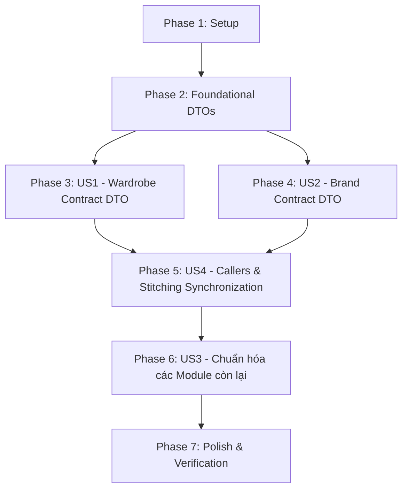

# Danh Sách Công Việc (Tasks): Tách Biệt Contract DTO Và Chuẩn Hóa Ranh Giới Dữ Liệu Giữa Các Module

**Input**: Tài liệu thiết kế từ `specs/018-contract-dto-refactor/` (`spec.md`, `plan.md`, `research.md`, `data-model.md`, `contracts/`, `quickstart.md`)  
**Prerequisites**: `plan.md`, `spec.md`, `data-model.md`, `contracts/`  
**Quy ước định dạng**: `- [x] [TaskID] [P?] [Story?] Mô tả công việc kèm đường dẫn file`  
- `[P]`: Có thể thực hiện song song (khác file, không phụ thuộc vào task chưa hoàn thành)  
- `[Story]`: User Story tương ứng (`[US1]`, `[US2]`, `[US3]`, `[US4]`)  

---

## Phase 1: Setup (Khởi Tạo Cơ Sở Hạ Tầng)

**Mục đích**: Chuẩn bị nền tảng và kiểm tra môi trường làm việc trước khi refactor.

- [x] T001 Xác minh trạng thái hiện tại của codebase với `make lint` và `go build ./...`
- [x] T002 Kiểm tra và ghi nhận các contract interface hiện tại trong `internal/modules/wardrobe/presentation/contract/` và `internal/modules/brand/presentation/contract/`

---

## Phase 2: Foundational (Khai Báo DTO Cốt Lõi)

**Mục đích**: Khai báo các Contract DTO thuần túy (Pure DTOs) làm nền tảng cho việc refactor contract ở Phase 3 & 4.

- [x] T003 [P] Tạo struct `WardrobeItemContractDTO` trong `internal/modules/wardrobe/application/dto/contract_dto.go`
- [x] T004 [P] Tạo struct `BrandItemContractDTO` trong `internal/modules/brand/application/dto/contract_dto.go`

---

## Phase 3: User Story 1 - Chuẩn Hóa Contract DTO Của Module Wardrobe (Priority: P1) 🎯 MVP

**Mục tiêu**: Thuần hóa `IWardrobeContract`, trả về `WardrobeItemContractDTO` thay vì `WardrobeItemRes`, loại bỏ trường `FashionItem` và `BrandItem` lồng nhau khỏi hợp đồng tủ đồ.  
**Tiêu chí kiểm thử độc lập**: Triển khai `WardrobeContractUseCase` và `WardrobeContract` trả về `WardrobeItemContractDTO` chứa thuộc tính tủ đồ và `FashionItemID *uuid.UUID`.

- [x] T005 [P] [US1] Bổ sung hàm mapper `MapToWardrobeItemContractDTO` và `MapToWardrobeItemContractDTOList` trong `internal/modules/wardrobe/application/mapper/wardrobe.go`
- [x] T006 [US1] Cập nhật interface `IWardrobeContractUseCase` trả về `*dto.WardrobeItemContractDTO` trong `internal/modules/wardrobe/application/interface/usecase/contract_uc.go`
- [x] T007 [US1] Cập nhật implementation `WardrobeContractUseCase` sử dụng mapper mới trong `internal/modules/wardrobe/application/usecase/wardrobe/contractuc/contract_uc.go`
- [x] T008 [US1] Cập nhật interface `IWardrobeContract` sử dụng `*dto.WardrobeItemContractDTO` trong `internal/modules/wardrobe/presentation/contract/wardrobe_contract.go`
- [x] T009 [US1] Cập nhật implementation `WardrobeContract` trong `internal/modules/wardrobe/presentation/contract/wardrobe_contract_impl.go`

---

## Phase 4: User Story 2 - Chuẩn Hóa Contract DTO Của Module Brand (Priority: P1)

**Mục tiêu**: Thuần hóa `IBrandContract`, trả về `BrandItemContractDTO` thay vì `BrandItemBriefRes` / `BrandItemRes`, loại bỏ trường `FashionItem` lồng nhau khỏi hợp đồng nhãn hàng.  
**Tiêu chí kiểm thử độc lập**: Triển khai `BrandItemContractUseCase` và `BrandContract` trả về `BrandItemContractDTO` chứa thuộc tính nhãn hàng và `FashionItemID uuid.UUID`.

- [x] T010 [P] [US2] Bổ sung hàm mapper `MapToBrandItemContractDTO` và `MapToBrandItemContractDTOList` trong `internal/modules/brand/application/mapper/brand_item_mapper.go`
- [x] T011 [US2] Cập nhật interface `IBrandItemContractUseCase` trả về `*dto.BrandItemContractDTO` trong `internal/modules/brand/application/interface/usecase/brand_item_contract_uc.go`
- [x] T012 [US2] Cập nhật implementation `BrandItemContractUseCase` sử dụng mapper mới trong `internal/modules/brand/application/usecase/item/contractuc/contract_uc.go`
- [x] T013 [US2] Cập nhật interface `IBrandContract` sử dụng `*dto.BrandItemContractDTO` trong `internal/modules/brand/presentation/contract/brand_contract.go`
- [x] T014 [US2] Cập nhật implementation `BrandContract` trong `internal/modules/brand/presentation/contract/brand_contract_impl.go`

---

## Phase 5: User Story 4 - Đồng Bộ Hóa Callers, Workers, Mappers Và Bảo Đảm Tương Thích Ngược API (Priority: P1/P3)

**Mục tiêu**: Cập nhật tất cả các Consumer Modules gọi `IWardrobeContract` và `IBrandContract` sang kiểu `ContractDTO`, tự thực hiện stitching bằng `sliceutils.IndexBy`, cập nhật Test Mocks và bảo đảm API Client giữ nguyên schema.  
**Tiêu chí kiểm thử độc lập**: `go build ./...` và `make test-race` vượt qua thành công, các API endpoints `/api/v1/wardrobe/items` và `/api/v1/brand/items` giữ nguyên vẹn cấu trúc JSON response.

- [x] T015 [US4] Cập nhật Caller gọi `wardrobeContract` và `brandContract` trong `internal/modules/fashion/application/usecase/ai/recommendation/usecase.go` & `workflow_helpers.go`
- [x] T016 [US4] Cập nhật Caller gọi `wardrobeContract` và `brandContract` trong `internal/modules/fashion/application/usecase/ai/chat/usecase.go` & `workflows.go`
- [x] T017 [US4] Cập nhật Background Workers (`CleanupFailedItems`, `RecoverStaleProcessingItems`) xử lý nil-guard `FashionItemID` trong `internal/modules/fashion/application/usecase/worker/cleanup_uc.go` và `worker_uc.go`
- [x] T018 [US4] Cập nhật Caller gọi `wardrobeContract` trong `internal/modules/fashion/application/usecase/category/category_uc.go`
- [x] T019 [US4] Cập nhật Caller gọi `brandContract` trong `internal/modules/wardrobe/application/usecase/wardrobe/item/item_uc_read.go` & `item_uc_write.go`
- [x] T020 [US4] Cập nhật Caller gọi `brandContract` trong `internal/modules/wardrobe/application/usecase/wardrobe/catalog/catalog_uc.go` & `internal/modules/wardrobe/application/usecase/outfit/outfit_uc.go`
- [x] T021 [US4] Cập nhật Caller gọi `wardrobeContract` và `brandContract` trong `internal/modules/dashboard/application/usecase/user_dashboard_uc_impl.go` & `brand_dashboard_uc_impl.go`
- [x] T022 [US4] Cập nhật Caller gọi `brandContract` trong `internal/modules/dashboard/application/usecase/admin_dashboard_uc_impl.go`, `drilldown_uc_impl.go`, `dynamic_query_uc_impl.go`
- [x] T023 [US4] Cập nhật mock interfaces và unit tests trong `internal/modules/fashion/application/usecase/worker/worker_uc_test.go` và `workflows_test.go`
- [x] T024 [US4] Cập nhật mock interfaces và unit tests trong `internal/modules/dashboard/application/usecase/*_test.go`
- [x] T025 [US4] Kiểm tra bảo đảm các DTO phục vụ API Handler (`WardrobeItemRes`, `BrandItemRes`) giữ nguyên vẹn 100% cấu trúc JSON response

---

## Phase 6: User Story 3 - Chuẩn Hóa Cấu Trúc `contract_dto.go` Cho Các Module Khác (Priority: P2)

**Mục tiêu**: Tạo `contract_dto.go` cho `identity`, `subscription`, `fashion`, `admin`, `notification` nhằm đạt sự nhất quán 100% về mặt tổ chức thư mục DTO toàn dự án.  
**Tiêu chí kiểm thử độc lập**: Mỗi module có `presentation/contract/` đều có file `application/dto/contract_dto.go` định nghĩa kiểu dữ liệu phục vụ contract tương ứng.

- [x] T026 [P] [US3] Tạo `contract_dto.go` và chuẩn hóa DTO cho `IUserBriefContract` trong `internal/modules/identity/application/dto/contract_dto.go`
- [x] T027 [P] [US3] Tạo `contract_dto.go` và chuẩn hóa DTO cho `IUserSubscriptionContract` & `IUserQuotaContract` trong `internal/modules/subscription/application/dto/contract_dto.go`
- [x] T028 [P] [US3] Tạo `contract_dto.go` và chuẩn hóa DTO cho `IFashionContract` & `ICategoryContract` trong `internal/modules/fashion/application/dto/contract_dto.go`
- [x] T029 [P] [US3] Tạo `contract_dto.go` và chuẩn hóa DTO cho `IAuditLogContract` trong `internal/modules/admin/application/dto/contract_dto.go`
- [x] T030 [P] [US3] Tạo `contract_dto.go` và chuẩn hóa DTO cho `INotificationContract` trong `internal/modules/notification/application/dto/contract_dto.go`

---

## Phase 7: Polish & Kiểm Tra Toàn Diện (Cross-Cutting Concerns)

**Mục đích**: Xác thực toàn bộ hệ thống biên dịch sạch, linter đạt chuẩn, test suite vượt qua và cập nhật tài liệu kiến trúc.

- [x] T031 Chạy `make wire` để tái sinh và kiểm tra Dependency Injection toàn dự án
- [x] T032 Chạy `go build ./...` xác nhận 100% mã nguồn biên dịch thành công
- [x] T033 Chạy `make lint` đảm bảo không có vi phạm formatting hoặc static analysis
- [x] T034 Chạy `make test-race` đảm bảo toàn bộ unit/integration tests pass và không có race condition
- [x] T035 Cập nhật tài liệu kiến trúc `docs/system-design/contract-purity-pattern.md` phản ánh quy chuẩn `contract_dto.go` mới

---

## Thứ Tự Phụ Thuộc (Dependency Graph)

---

## Chiến Lược Triển Khai (Implementation Strategy)

1. **MVP Scope (Phase 2, 3, 4, 5)**:
   - Tập trung giải quyết dứt điểm rò rỉ quan hệ `FashionItem` trong `Wardrobe` và `Brand`.
   - Ngay sau khi hoàn thành Phase 5, toàn bộ các luồng cốt lõi của Wardrobe, Brand, Fashion Recommendation và Dashboard đều hoạt động chuẩn xác với DTO thuần khiết.
2. **Standardization Scope (Phase 6)**:
   - Mở rộng quy chuẩn `contract_dto.go` sang các module còn lại mà không làm xáo trộn logic nghiệp vụ.
3. **Verification (Phase 7)**:
   - Khóa chặt chất lượng qua `make wire && make lint && make test-race`.
